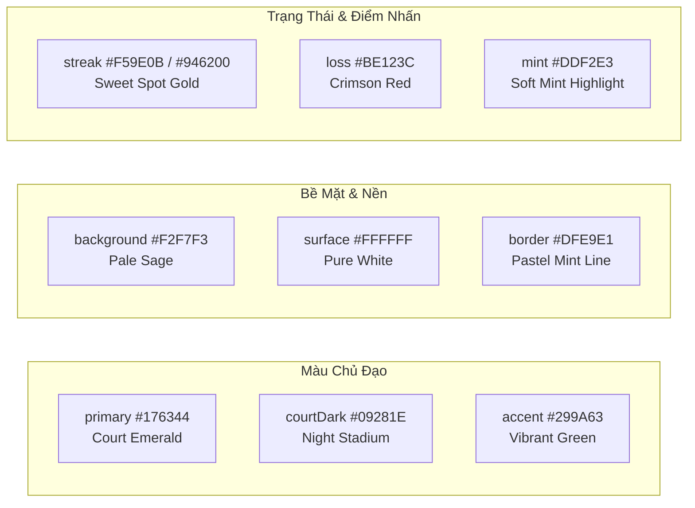

# SportXP — Master Design System (DESIGN.md)

> **Tài liệu quy chuẩn thiết kế giao diện (Single Source of Truth - SSOT)** cho toàn bộ ứng dụng **SportXP** trên Flutter di động, tablet và web.  
> Được xây dựng theo triết lý **Sport Tech / Fresh Athletic Minimalism** kết hợp kiến trúc **Bento UI** (Apple & Linear design language) và tiêu chuẩn chất lượng nghiêm ngặt của [taste-skill](file:///.agents/skills/taste-skill/SKILL.md).

---

## 1. Triết Lý Thiết Kế & Định Vị Thương Hiệu (Brand Identity)

### 1.1 Tinh thần cốt lõi (Design Read)
* **Tên sản phẩm:** `SportXP` (In hoa: `SPORTXP`).
* **Slogan định vị:** *"MỖI SET CẦU • MỘT BƯỚC TIẾN"* (Khắc họa hành trình tích lũy điểm kinh nghiệm XP, nâng hạng Elo và thăng tiến phong độ qua từng trận cầu lông).
* **Phong cách chủ đạo:** **Sport Tech / Fresh Athletic Minimalism**.
  * **Sân đấu làm cảm hứng:** Sắc xanh thảm đấu ngọc lục bảo (Emerald / Forest Green), đường biên kẻ vạch sân cầu lông sắc nét, ánh đèn spotlight và chóp cầu vàng hoàng kim (Streak Gold).
  * **Chống rập khuôn (Anti-Slop Discipline):** Không dùng gradient tím xanh AI tùy tiện, không dùng bóng đổ đen thô cứng, không dùng thẻ trắng trên nền trắng mất tương phản, triệt để loại bỏ layout dàn trải đơn điệu.
* **Cấu hình chỉ số điều hướng (Core Design Dials):**
  * `DESIGN_VARIANCE: 7` (Bố cục bất đối xứng có nhịp điệu, cấu trúc Bento thông minh).
  * `MOTION_INTENSITY: 5` (Chuyển động thể thao mượt mà, gia tốc `easeOutCubic`, không giật cục).
  * `VISUAL_DENSITY: 4` (Không gian thoáng đãng, số liệu thể thao dễ đọc khi đang di chuyển trên sân).

---

## 2. Hệ Thống Màu Sắc (Color Tokens — [`AppColors`](file:///lib/core/theme/app_theme.dart#L3-L20))

Toàn bộ bảng màu được quy chuẩn tập trung tại [`lib/core/theme/app_theme.dart`](file:///lib/core/theme/app_theme.dart):

### 2.1 Bảng màu chi tiết & Vai trò ngữ nghĩa (Semantic Tokens)

| Token | Mã Hex / Gradient | Vai trò & Ứng dụng cụ thể trong UI | Tỉ lệ tương phản (Contrast) |
| :--- | :--- | :--- | :--- |
| `primary` | `#176344` | **Xanh Emerald đậm (Forest Green)**: Nút CTA chính (`FilledButton`), Tab chọn, Badge trạng thái tích cực, Icon chính, vạch sân thể thao. | **12.4:1** trên nền trắng |
| `accent` | `#299A63` | **Xanh lá sân đấu tươi sáng (Vibrant Court)**: Điểm nhấn năng động, dải màu phụ trong Gradient tiêu đề, đường kẻ sân phát sáng. | Tương phản bổ trợ |
| `headerGradient` | Gradient `#176344` ➔ `#299A63` | AppBar, Header thẻ Passport, Banner sự kiện thể thao lớn. | Đồng nhất nhận diện |
| `background` | `#F2F7F3` | **Nền xám ánh xanh sương mai (Pale Sage)**: Nền toàn bộ ứng dụng (Scaffold Background). Dịu mắt hơn màu trắng chói lóa, giúp thẻ nổi bật. | Nền tảng toàn app |
| `surface` | `#FFFFFF` | **Bề mặt thẻ (Card Surface)**: Nền của [`BentoCard`](file:///lib/shared/widgets/bento_card.dart), Modal Bottom Sheet, Input Textfield. | Nổi trên nền `#F2F7F3` |
| `border` | `#DFE9E1` | **Đường viền xanh ngọc pastel**: Viền mỏng 1px của toàn bộ thẻ Bento, nút bấm outline, phân cách ô nhập liệu. | Thay thế viền đen/xám xỉn |
| `mint` | `#DDF2E3` | **Xanh bạc hà nhạt (Soft Mint)**: Nền của thẻ được Highlight, Indicator của `NavigationBar`, Chip lọc đang chọn, Nan lông vũ logo. | Phân vùng êm dịu |
| `text` | `#14251D` | **Đen xanh rừng sâu (Dark Forest)**: Màu chữ chính (Typography Primary). Độ sâu thị giác cao hơn đen tuyền `#000000`, hài hòa với gam xanh. | **15.2:1** trên nền trắng |
| `muted` | `#61736A` | **Xám tro ánh xanh (Sage Grey)**: Phụ đề, nhãn metadata, thời gian, placeholder, icon thứ cấp. | **4.6:1** (Đạt chuẩn WCAG AA) |
| `streak` | `#F59E0B` / `#946200` | **Vàng hổ phách / Hoàng kim (Streak Gold)**: Chuỗi trận thắng liên tiếp (Win Streak), Cúp vàng Top 1 BXH, Chóp bần quả cầu lông, Trạng thái chờ chỗ. | Nổi bật trên cả nền sáng/tối |
| `loss` | `#BE123C` | **Đỏ mận thể thao (Crimson Rose)**: Thất bại, hủy kèo đấu, thông báo cảnh báo nguy hiểm, nút Đăng xuất. | Cảnh báo trực quan |

### 2.2 Quy tắc dùng màu (Color Rules)
* **Khóa bảng màu (Color Consistency Lock):** Toàn app sử dụng nhất quán dải xanh Emerald kết hợp vàng kim Streak Gold. Tuyệt đối không tự ý thêm các màu ngẫu hứng (tím neon, cam chói, xanh dương).
* **Độ tương phản bắt buộc (Contrast Check):**
  * Chữ trên nút bấm hoặc thẻ luôn đạt tối thiểu **4.5:1** (tiêu chuẩn WCAG AA).
  * Chữ lớn và chỉ số thể thao đạt tối thiểu **3.0:1**.
  * Không bao giờ đặt chữ trắng/bạc hà trên bề mặt thẻ trắng tinh (bài học khắc phục trên Splash Screen).

---

## 3. Hệ Thống Typography & Chỉ Số Thể Thao ([`AppTokens`](file:///lib/core/theme/app_theme.dart#L22-L32))

### 3.1 Phân cấp chữ (Type Scale)

| Cấp bậc | Cỡ chữ (Size) | Độ đậm (Weight) | Tracking / Spacing | Màu quy định | Trường hợp sử dụng |
| :--- | :--- | :--- | :--- | :--- | :--- |
| **Brand Title** | 34px / 18px | 900 (Black) | 2.0 đến 5.0 | `AppColors.text` / Trắng | Logo text SPORTXP trên Splash, Auth, AppBar |
| **Metric Large** | 28px | 800 (ExtraBold) | Tabular Figures | `AppColors.text` / `primary` | Chỉ số Elo, Điểm số set đấu, Chuỗi thắng, Số lượng slot |
| **Headline Medium** | 20px - 22px | 800 (ExtraBold) | -0.3 | `AppColors.text` | Tiêu đề kèo đấu (`room.title`), Tiêu đề bục BXH |
| **Title Small** | 16px - 17px | 700 (Bold) | -0.2 | `AppColors.text` | Tiêu đề khối Bento, Tên người chơi, Tên sân |
| **Body Regular** | 14px - 15px | 500 (Medium) | Bình thường | `AppColors.text` | Nội dung mô tả, ngày giờ thi đấu, thể thức thi đấu |
| **Label / Metadata** | 12px | 600 (SemiBold) | 0.2 | `AppColors.muted` | Phụ đề, khoảng cách điểm Elo, nhãn chi tiết |
| **Badge Micro** | 10px - 10.5px | 800 (ExtraBold) | 0.5 đến 1.4 | Theo trạng thái | Huy hiệu con nhộng (`ĐANG ĐẤU`, `CHỜ CHỖ`, Slogan) |

### 3.2 Quy chuẩn chữ số thể thao (Tabular Figures)
* Mọi số liệu nhảy động theo thời gian thực (Điểm Elo, tỉ số set, đếm ngược giờ, chuỗi thắng) **bắt buộc** áp dụng `fontFeatures: [FontFeature.tabularFigures()]` thông qua [`AppTokens.metric`](file:///lib/core/theme/app_theme.dart#L26-L30).
* **Lý do:** Giữ độ rộng các con số cố định như font đơn khoảng (monospaced), triệt tiêu hiện tượng giật rung lắc giao diện khi điểm số thay đổi.

---

## 4. Không Gian, Hình Khối & Lưới Bento (Spatial System)

### 4.1 Thước đo nhịp điệu (Spacing Scale)
Ứng dụng tuân thủ nhịp cơ sở **8px** (với bước đệm tinh chỉnh 4px):
`4px` ➔ `8px` ➔ `12px` ➔ `16px` ➔ `20px` ➔ `24px` ➔ `32px` ➔ `40px` ➔ `48px`.

* **Padding màn hình chuẩn:** `16px` ở hai cạnh biên di động (`EdgeInsets.fromLTRB(16, 16, 16, 100)`).
* **Padding trong thẻ Bento:** `18px - 20px` tạo độ thoáng đãng cao cấp.
* **Khoảng cách giữa các thẻ:** `16px` (ListView separator).

### 4.2 Khóa tỷ lệ bo góc (Shape Consistency Lock)
* **Thẻ Bento, Modal Sheet & Container lớn:** `radius = 20.0` ([`AppTokens.radius`](file:///lib/core/theme/app_theme.dart#L23)).
* **Nút bấm (`FilledButton`), Ô nhập liệu (`TextField`):** `radius = 14.0`.
* **Badge con nhộng, Chip lọc & Slogan:** `radius = 6.0` (Badge góc vuông nhẹ) hoặc `20.0` (Full Pill).
* **Tuyệt đối tránh:** Trộn lẫn nút góc vuông sắc lẹm (0px) với thẻ bo tròn lớn (20px).

### 4.3 Giới hạn màn hình lớn (Responsive Constraint)
* **Độ rộng tối đa:** `AppTokens.contentWidth = 720.0` được bọc bên trong [`PageContent`](file:///lib/shared/widgets/bento_card.dart#L37-L53).
* Giúp toàn bộ màn hình khi chạy trên iPad, Tablet, Màn hình gập hoặc Web Desktop tự động căn giữa cân đối, không bao giờ bị bè ngang vỡ giao diện.
* **Vùng chạm tối thiểu (Touch Target):** Mọi nút bấm và biểu tượng tương tác đạt kích thước tối thiểu `48 × 48px` ([`AppTokens.touchTarget`](file:///lib/core/theme/app_theme.dart#L24)) đáp ứng chuẩn WCAG.

---

## 5. Danh Mục Component Chuẩn (Component Specifications)

### 5.1 Thẻ Bento chuẩn ([`BentoCard`](file:///lib/shared/widgets/bento_card.dart#L5-L35))
* **Cấu trúc:** Lớp `Material` trắng, bo góc 20px, viền `1px solid AppColors.border`.
* **Thuộc tính `highlighted`:** Phủ một lớp gradient chéo dịu mát từ `AppColors.mint` về `AppColors.surface` (`stops: [0.0, 0.65]`), dùng cho các thẻ quan trọng nhất trên màn hình (Hồ sơ chính, Kèo đấu hot, Thông báo nổi bật).

### 5.2 Thẻ Kèo đấu ([`RoomCard`](file:///lib/features/rooms/presentation/widgets/room_card.dart))
* **Cấu trúc thông tin phân cấp rõ ràng (Hierarchy):**
  1. **Hàng Badge trên cùng:** Slot chỗ trống còn lại (`ĐÃ ĐẦY` / `CÒN 2 CHỖ`) + Huy hiệu trạng thái tham gia (`ĐÃ VÀO`, `CHỜ CHỖ`, `CẦN XÁC NHẬN`) + Trạng thái bảo mật (`Riêng tư · Vào bằng mã`).
  2. **Tiêu đề buổi chơi:** Chữ đậm 19px, bold 800, tối đa 2 dòng.
  3. **Thời gian thi đấu:** Icon `Icons.schedule_rounded` xanh `primary` + Khoảng thời gian dạng Tabular Figures.
  4. **Địa điểm sân thi đấu:** Icon `Icons.place_outlined` xám `muted` + Tên sân & Quận huyện.
  5. **Chân thẻ:** Avatar Host + Trình độ yêu cầu (Dải Elo hoặc Nhóm trình) + Phí tham gia / người.

### 5.3 Huy hiệu trạng thái (Badges & Pills)
Sử dụng công thức màu nền trong suốt 12-15% + Viền cùng tông màu:
* **Đang đấu (Active):** Nền `primary` 15% opacity, viền `primary`, icon quả cầu lông, chữ xanh `primary`.
* **Đã vào (Registered):** Nền `primary` 15% opacity, viền `primary` 50%, chữ `primary`.
* **Chờ chỗ (Waitlist):** Nền `streak` 15% opacity, viền `streak` 60%, chữ vàng hổ phách `streak`.
* **Cần xác nhận / Hủy:** Nền `loss` 15% opacity, viền `loss` 60%, chữ đỏ `loss`.
* **Đã kết thúc (Completed):** Nền `border`, chữ xám `muted`.

### 5.4 Bục vinh danh BXH Top 3 (Leaderboard Podium)
* Bục Top 1 ở giữa (Vàng kim `#F59E0B`, bục nâng cao nhất), Top 2 bên trái (Bạc), Top 3 bên phải (Đồng).
* Hiển thị Avatar tròn, Vương miện / Badge số, Tên người chơi và Điểm Elo nổi bật.
* Thẻ cá nhân cố định ở đáy màn hình hiển thị vị trí xếp hạng của chính người dùng và khoảng cách điểm Elo tới người liền kề phía trên.

### 5.5 Hộ chiếu thể thao (Sports Passport Sheet)
* Tỷ lệ khung hình **9:16** chuẩn Story / Thẻ cầu thủ chuyên nghiệp.
* Nền xanh đen huyền bí `Court Dark (#09281E)` kết hợp vạch sân cầu lông viền sáng.
* Hiển thị mã QR định danh cá nhân, chỉ số Elo, phong độ chuỗi trận, nhịp tim và calo tiêu thụ (từ Health Connect / Apple Health khi người dùng đồng ý cấp quyền).

---

## 6. Ngôn Ngữ Chuyển Động & Hoạt Họa (Motion Language)

* **Đường cong gia tốc tiêu chuẩn:** `Curves.easeOutCubic` cho xuất hiện/lướt vào; `Curves.easeInOut` cho hiệu ứng phát quang nhịp thở.
* **Thời lượng phản hồi (Timing Rhythms):**
  * Phản hồi chạm tương tác (Micro-feedback): `150ms - 200ms`.
  * Chuyển tab / Modal sheet trượt lên: `280ms - 350ms`.
  * Chuyển cảnh Splash Screen: `2200ms` với chuỗi `TweenSequence` 4 pha phát sáng ánh ngọc lục bảo.
* **Nguyên tắc giảm chuyển động (Reduced Motion):** Luôn kiểm tra `MediaQuery.of(context).disableAnimations` để tắt các chuyển động dài đối với người dùng bật trợ năng.

---

## 7. Tài Nguyên Thương Hiệu & Vector Họa Tiết (Brand Assets)

Toàn bộ tài nguyên gốc được bảo quản tại `public/brand_public/` và được đồng bộ vào `assets/brand/`:

| Tên file | Kích thước | Mô tả & Mục đích sử dụng |
| :--- | :--- | :--- |
| `app_icon_master.png` | 512 × 512 | Master Squircle 3D dập nổi viền ngọc, quả cầu bọc bần Streak Gold, XP Mint phát quang |
| `symbol.png` | 512 × 512 | Biểu tượng XP Monogram tách nền, màu bạc hà phát quang (dùng trên nền tối / đĩa ngọc) |
| `symbol_light.png` | 512 × 512 | Biểu tượng XP vector tách nền, màu Xanh rừng thẳm `#134E3F` (dùng trên nền sáng) |
| `logo_vertical_dark.png` | 640 × 760 | Logo dọc trung tâm nền tối dành cho Splash Screen & Phim giới thiệu |
| `logo_horizontal.png` | 960 × 280 | Logo ngang chính thức nền sáng kèm Slogan tiếng Việt |
| `_BadmintonCourtPainter` | Vector Canvas | Bộ vẽ họa tiết vạch sân cầu lông chìm (Doubles lines, Short service, Center line, Net) |

---

## 8. Bảng Kiểm Tra Tiêu Chuẩn Xuất Xưởng (Pre-Flight Checklist)

Trước khi phát hành bất kỳ màn hình hoặc tính năng mới nào, lập trình viên và designer phải kiểm tra danh sách này:

* [ ] **Độ tương phản (WCAG AA):** Chữ trên nút bấm, badge và thẻ đạt tối thiểu 4.5:1. Tuyệt đối không để xảy ra lỗi logo/chữ bị chìm vào nền.
* [ ] **Khóa hình khối (Shape Lock):** Thẻ đạt 20px bo góc, nút/input đạt 14px bo góc, touch target >= 48px.
* [ ] **Chữ số thể thao:** Tất cả số liệu Elo, thời gian, kết quả trận đấu dùng `AppTokens.metric` hoặc `FontFeature.tabularFigures()`.
* [ ] **Màn hình hẹp & Co giãn chữ:** Kiểm tra hiển thị tốt trên màn hình hẹp 320px/360px và khi kích hoạt Text Scaling 200%.
* [ ] **Đầy đủ 4 trạng thái UI:** Luôn thiết kế đủ Loading (Skeleton), Empty State (có hướng dẫn hành động), Error State (có nút Thử lại) và Thành công.
* [ ] **Phân vùng nội dung:** Bọc trong [`PageContent`](file:///lib/shared/widgets/bento_card.dart) với `maxWidth: 720` để giao diện luôn hoàn hảo trên Tablet/Web.
